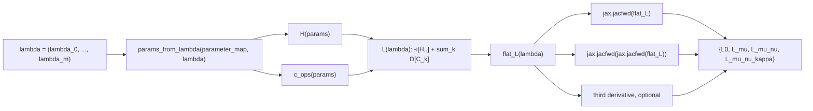
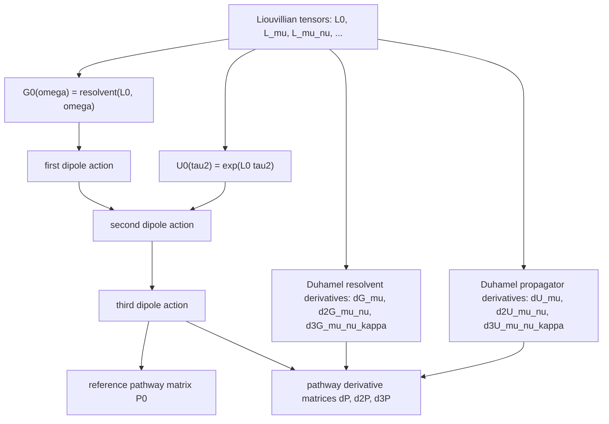
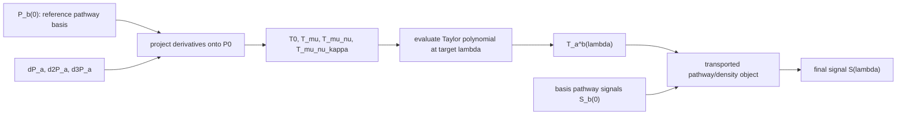

# Autodiff Nodal Structure for Liouville Transport

This note describes how the autodiff backend views the current implementation.
The central computational object is the Liouvillian as a function of selected
dimensionless control coordinates,

```text
L(lambda) = L[p_ref + delta * lambda].
```

Autodiff is used only to differentiate this map. The downstream Duhamel and
transport layers consume the resulting Liouvillian derivative tensors and build
the transport expansion

```text
P_a(lambda) ~= sum_b T_a^b(lambda) P_b(0).
```

The final signal is formed after transport by summing pathway signals or,
equivalently, tracing the transported density object against the detection
operator.

## Node Types

| Layer | Node | Code Location | Role |
| --- | --- | --- | --- |
| Controls | `lambda` | user input | Dimensionless displacement from the reference model. |
| Parameters | `params(lambda)` | `Liouville_autodiff.params_from_lambda` | Maps selected controls into the full physical parameter dictionary. |
| Model | `H(params)` | user model, e.g. `exciton_dimer_autodiff.py` | Hamiltonian node. |
| Model | `c_ops(params)` | user model, e.g. `exciton_dimer_autodiff.py` | Lindblad collapse-operator nodes. |
| Model | `L(params)` | `jax_exciton_dimer_liouvillian` or user JAX Liouvillian | Liouville generator assembled from Hamiltonian and dissipators. |
| Autodiff | `flat_L(lambda)` | `Liouville_autodiff.jax_liouvillian_derivatives_from_lambda` | Vectorized Liouvillian supplied to `jax.jacfwd`. |
| Connections | `L_mu`, `L_mu_nu`, `L_mu_nu_kappa` | `Liouville_autodiff.py` | Liouvillian connection tensors with respect to selected controls. |
| Propagators | `G(omega; L)`, `U(t; L)` | `Liouville_duhamel.py` | Resolvent and waiting-time propagator. |
| Duhamel | `dG`, `dU` | `Liouville_duhamel.py` | Duhamel insertion expansion using Liouvillian derivative tensors. |
| Pathways | `P_a(lambda)` | `Liouville_transport_expansion.py` and `fit_v_system_transport_signal.py` | Phase-matched pathway-state vectors on the 2D frequency grid. |
| Projection | `T_a^b(lambda)` | `project_transport_derivative(...)` | Least-squares projection of pathway derivatives onto the reference basis. |
| Signal | `S(lambda)` | demo and notebook scripts | Observable signal after transport. |

## View 1: What JAX Differentiates

JAX sees a pure function from the selected control vector to a complex
Liouville-space matrix. In the current beta implementation, the dipole operator
and initial state are used downstream but are not part of the differentiated
JAX graph unless a future model explicitly makes them control-dependent.



The important design constraint is that the path from `lambda` to `L(lambda)`
must be written in JAX-compatible operations. That is why the dimer has a
separate `exciton_dimer_autodiff.py`: it mirrors the NumPy model but avoids
Python-side branching that would break tracing.

## View 2: Duhamel Expansion Graph

Once the Liouvillian connection tensors are available, the Duhamel layer does
not need to know how they were obtained. The same graph can consume autodiff
or finite-difference derivatives.



Conceptually, each derivative corresponds to inserting one or more connection
operators into the resolvent/propagator factors along a Liouville pathway. For
example, a first derivative of a resolvent has the schematic form

```text
dG_mu = -G0 L_mu G0
```

with higher orders containing all ordered insertions plus any higher
Liouvillian derivatives supplied by the backend.

## View 3: Transport Matrix and Final Signal

The transport matrix is a projected representation of distorted pathway states
in the reference pathway basis. It is not required to be norm preserving; it is
a mixing map between basis pathways.



In the current 2D demonstrations, the final signal is implemented as a weighted
sum of reference pathway signals,

```text
S_transport(lambda) = sum_a,b T_a^b(lambda) S_b(0),
```

after enforcing phase-matching sectors as independent blocks. This preserves
wave-vector conservation while still allowing pathway mixing within each
sector.

## Practical Backend Boundary

The intended boundary between model authors and the transport code is:

```text
user model
  H(params), c_ops(params), rho0(params), mu(params)
       |
       v
LiouvilleModel / JAX Liouvillian
       |
       v
{L0, L_mu, L_mu_nu, ...}
       |
       v
Duhamel pathway derivatives
       |
       v
T(lambda)
       |
       v
S_transport(lambda)
```

For a new model, the minimum user-facing responsibilities are:

1. Define a reference parameter dictionary.
2. Choose which parameters become control coordinates.
3. Provide `H(params)`, `c_ops(params)`, and the perturbation/dipole operator.
4. For autodiff, provide a JAX-compatible `L(lambda)` or
   `L(params_from_lambda(lambda))`.

Everything after the derivative tensor dictionary is model agnostic.

## Notes for the Next Implementation Pass

- The current autodiff path differentiates only the Liouvillian. If the dipole
  operator or initial state becomes control-dependent, the graph should be
  extended to include derivative nodes for those objects.
- The finite-difference backend is useful as a reference because it exercises
  the same Duhamel/transport graph with derivative tensors from a different
  source.
- Third-order transport is already represented in the graph, but the waiting
  time propagator uses explicit triple quadrature. Caching exponentials or using
  block/Frechet methods would improve the performance of that node.
